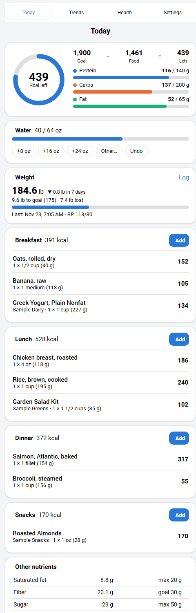
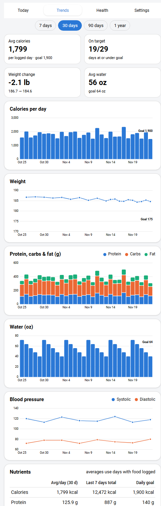
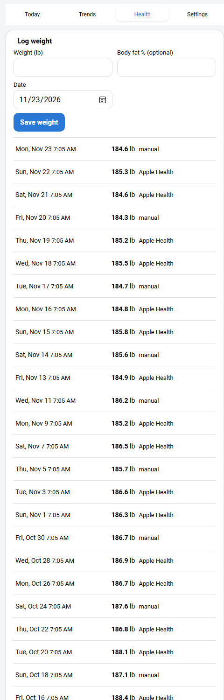
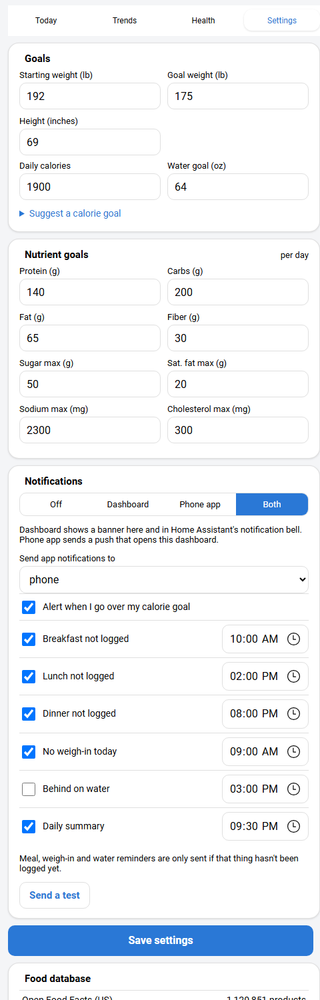

# Weight Tracker for Home Assistant

A self-hosted food, weight and health log that lives in Home Assistant. Built to replace a paid calorie-counting app subscription: scan a barcode, pick a portion, and your day's calories and nutrients add up. Your data stays on your own server.

| Today | Trends | Health | Settings |
|---|---|---|---|
|  |  |  |  |

*Screenshots use made-up demo data.*

## Features

- **Food log** for breakfast, lunch, dinner and snacks. Search, recents, favorites, quick-add calories, your own custom foods, and "copy from the day before".
- **Barcode scanning.** In the Home Assistant iOS/Android app it uses the app's native scanner. In a browser it uses the camera (BarcodeDetector, or ZXing as a fallback).
- **Your own food database server** with about 3 million foods from [Open Food Facts](https://world.openfoodfacts.org) (US products) and [USDA FoodData Central](https://fdc.nal.usda.gov) (branded, foundation and SR legacy), updated every night. Barcodes it doesn't know fall back to the live Open Food Facts API.
- **Goals:** goal weight, daily calories (with a Mifflin-St Jeor calculator), and goals for protein, carbs, fat, fiber, sugar, sodium, saturated fat and cholesterol.
- **Water** with one-tap +8 / +16 / +24 oz buttons.
- **Weight and blood pressure**, entered by hand or synced from **Apple Health** through an iOS Shortcut (so any scale or cuff that writes to Health works). It can also write your daily calories and water back to Health.
- **Trends:** 7 / 30 / 90 / 365 day charts of calories, weight, macros, water and blood pressure, plus a nutrients table (average per day, last-7-days total, goal).
- **Notes** for anything else.
- **Reminders and alerts** (meal reminders, weigh-in, water, daily summary, over-goal) to the dashboard, the companion app, or both.
- **15 sensors** (`sensor.weight_tracker_*`) for calories today/remaining/7-day average, macros, sodium, water, weight, weight to goal and blood pressure, to use in your own automations and dashboards.
- **Light and dark mode** follow your Home Assistant theme.

## How it fits together

```
 Phone / browser                 Home Assistant                     Food DB server (LAN)
 weight-tracker-card  <──ws──>  custom_components/weight_tracker  ──http──>  fooddb/server.py :8080
                                   SQLite: /config/weight_tracker.db          SQLite FTS5, ~800 MB
 iOS Shortcut  ──webhook──>        (your log, settings, custom foods)          nightly update.py
```

## Install

### 1. Food database server

Any small always-on Debian or Ubuntu machine works: a VM, an LXC container (for example on Proxmox), or a Raspberry Pi 4/5 with enough disk. It needs **2 GB RAM** and about **10 GB free disk**.

```
git clone https://github.com/sbirchfield70/ha-weight-tracker
cd ha-weight-tracker/fooddb
sudo sh install.sh
```

The first build downloads about 3 GB and takes 30-60 minutes. After that, a timer applies the day's Open Food Facts changes at 03:15 and does a full rebuild on Sundays or when USDA publishes a new release. Check it with `curl http://<server>:8080/health`.

The API has no authentication, so keep it on your LAN. See [docs/food-database.md](docs/food-database.md) for details.

### 2. The integration

**HACS / Marketplace:** add this repository as a custom repository of type **Integration**, install **Weight Tracker**, and restart Home Assistant.

**Manually:** copy `custom_components/weight_tracker` into your `/config/custom_components/` and restart Home Assistant.

Then go to **Settings → Devices & services → Add integration → Weight Tracker** and enter your food database address, for example `http://192.168.1.50:8080`.

### 3. The card

1. Copy `www/weight-tracker-card.js` to `/config/www/`.
2. For barcode scanning in desktop browsers, also download [ZXing 0.21.3](https://unpkg.com/@zxing/library@0.21.3/umd/index.min.js) and save it as `/config/www/weight-tracker/zxing.min.js`. (The companion app doesn't need it.)
3. **Settings → Dashboards → ⋮ → Resources → Add resource:** URL `/local/weight-tracker-card.js`, type **JavaScript module**.
4. Create a dashboard called **Weight Tracker** with the URL `weight-tracker`, add a view with the path `today` and type **Panel**, and add the card:

```yaml
type: custom:weight-tracker-card
```

App notifications open `/weight-tracker/today`, so use that path if you want tapping a notification to land on the tracker. The tabs can be opened directly with `#trends`, `#health` or `#settings`.

**After updating the card**, change the resource URL to `...js?v=2` (then `v=3`, and so on) so browsers load the new version.

### 4. Settings

Open the card's **Settings** tab to set your goals, height and weights, pick where notifications go, choose your phone for app notifications, and turn reminders on or off.

### 5. Apple Health (optional)

See [docs/apple-health.md](docs/apple-health.md) to sync weight and blood pressure from Apple Health and write calories and water back.

## Services

| Service | What it does |
|---|---|
| `weight_tracker.log_weight` | Add a weight (and optional body fat) |
| `weight_tracker.log_water` | Add water in oz |
| `weight_tracker.log_bp` | Add a blood pressure reading |
| `weight_tracker.log_note` | Add a note |
| `weight_tracker.quick_add` | Add calories (and optional macros) to a meal |
| `weight_tracker.send_summary` | Send today's summary now |
| `weight_tracker.ingest` | Same as the webhook: accepts weight, BP, water and notes, returns today's totals |

## Preview without Home Assistant

```
cd ha-weight-tracker
python -m http.server 8765
```

Open `http://localhost:8765/demo/index.html` (add `#trends`, `#health` or `#settings`, or `?dark`).

## Notes

- Units are pounds, fluid ounces and US-style labels. The food database keeps US products from Open Food Facts; change `off_is_us()` in `fooddb/update.py` for another country.
- Your log is in `/config/weight_tracker.db`, which is included in Home Assistant backups. The food database can always be rebuilt, so it doesn't need backing up.
- Open Food Facts data is community-entered and sometimes wrong. The loader corrects the most common mistake (sodium or cholesterol entered in mg where grams are expected), but double-check anything that looks off, and save your own version as a custom food.
- This is not medical advice or a medical device.

## Data sources and license

Food data: [Open Food Facts](https://world.openfoodfacts.org) (Open Database License) and [USDA FoodData Central](https://fdc.nal.usda.gov) (public domain). Barcode fallback: [ZXing](https://github.com/zxing-js/library) (Apache 2.0).

Code: MIT, see [LICENSE](LICENSE).
